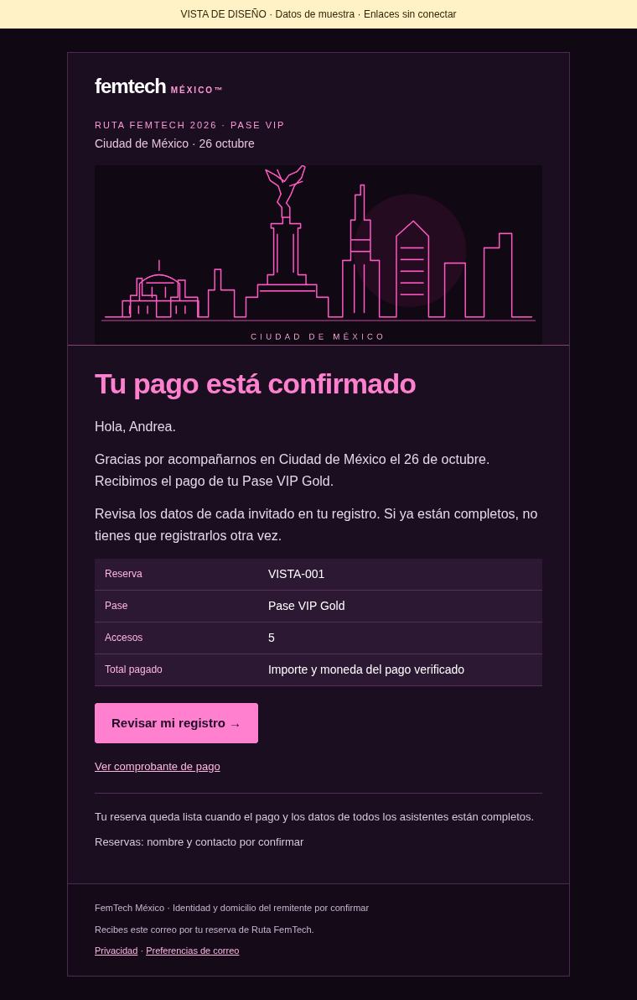
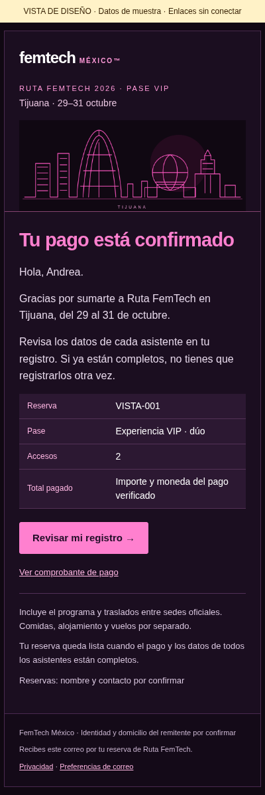

# Correos de compra · Ruta FemTech 2026

**6 correos CDMX + 6 correos Tijuana**, en español, con el diseño oscuro y rosa y el skyline de cada ciudad. Borradores para implementar en GHL; no están conectados ni enviados.

- [Leer los 12 correos](COPY-EMAILS.md).
- [Ver todos los diseños en GitHub](DESIGN-REVIEW.md).
- [Descargar el paquete de correos](https://github.com/Mayra-Prelude/TJ26/raw/refs/heads/main/entrega/FemTech-correos-compra.zip).
- [Instrucciones para Claude/GHL](HANDOFF-CLAUDE-GHL.md).
- [Disparadores, horarios y condiciones](WORKFLOWS.md).
- [Prompt para copiar en Claude](PROMPT-CLAUDE.txt).

Tras descargar/descomprimir, abre `index.html` para la galería. Para GHL utiliza `templates/`, no `preview/`: las vistas previas tienen datos ficticios e imágenes incrustadas. Contactos, horarios operativos, Airtable, comprobantes y otros enlaces requieren el mapeo indicado en `variables.json`.

## Contenido

| Paso | CDMX | Tijuana |
| --- | --- | --- |
| 01 | Pago recibido y revisión del registro | Pago recibido y revisión del registro |
| 02 | Datos pendientes de los cinco invitados | Datos pendientes del pase individual/dúo |
| 03 | Registro completo y materiales de empresa | Registro completo y coordinación de llegada |
| 04 | Horario, sede y acceso al cóctel | Programa, encuentro y traslados |
| 05 | Recordatorio del día anterior | Recordatorio del día anterior |
| 06 | Seguimiento de beneficios del pase | Agradecimiento y encuesta |

Las cantidades escalan con las unidades autorizadas. Un pago confirmado no sustituye el registro de todas las personas. Si Airtable ya está completo antes del pago, no se vuelve a solicitar. Las confirmaciones van al comprador; los accesos, a cada asistente.

## Vista de las confirmaciones

### CDMX

### Tijuana · móvil

## Verificación

`npm run test:purchase-emails`: 12 correos a 360, 400 y 760 px, imágenes sin red, variables, CTA principal, ausencia de datos del comprador en correos individuales y ajuste de textos largos. Capturas en `screenshots/`. Es una validación en Chromium; Claude debe probar los correos importados en los clientes de correo disponibles antes de activar.

Regenerar: `npm run build:purchase-emails`. Los textos editables están en `content.json`; los campos en `variables.json`. El diseño se genera con `generate.py`.
